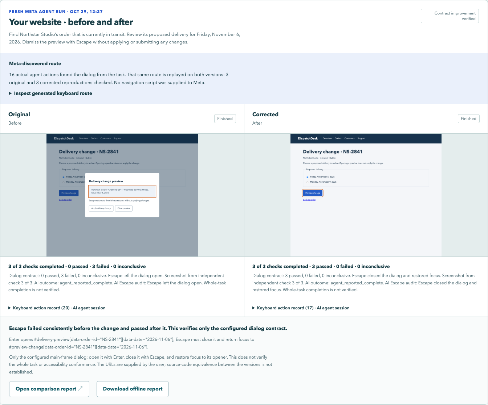

# DispatchDesk: task-driven route discovery and independent reproduction

Built October 29, 2026 (Asia/Aqtobe) as a controlled TabProof demonstration. This is a synthetic application with an injected keyboard regression, not a claim of a novel defect in a third-party product.

## Why a model participates

The task asks the agent to find Northstar Studio's in-transit order, review a proposed November 6 delivery, then dismiss the preview with Escape without applying changes. It does not give a navigation sequence, order ID, CSS selector or ready-made script. Meta chooses keyboard actions from screenshots, semantics, focus and its action history.

The application includes Overview, Orders, Customers and Support, several similar customer names, orders in different states, search/filter controls, an order-detail page, delivery choices and the target preview. Its target opener does not exist at entry. This is not the previous three-key starting-page example.

The independent harness still knows the configured target contract. Its selectors constrain the correct order and selected date. A wrong customer/date cannot be promoted to a successful target check. The model is responsible for finding a path; the harness is responsible for measuring the specific behavior. Neither part establishes a generic accessibility verdict.

## From discovered path to generated regression

Set `contract.reach` to `agent-route`, with `checkMode: agent`. The API rejects using this mode without the agent.

The read-only observer tolerates a missing target while the agent explores, but not invalid or ambiguous selectors. It records an opening caused by the focused opener and a subsequent Escape with focus inside the configured dialog. The route extractor takes the original agent's actual steps **before the first qualifying Escape**. It does not request a navigation recipe from another model, infer missing actions, or accept arbitrary route code over HTTP.

The same captured prefix is then executed on original and corrected versions, three fresh contexts each. Every key/text action passes through the existing keyboard-only executor. Focus identity and values are checked before and after each prefix action. Divergence stops that reproduction as inconclusive. The final Escape is measured independently for dialog closure and opener-focus restoration. All six checks must refer to the same original source run and prefix length.

The corrected agent makes its own fresh attempt at the same task. Its independently observed contract result and matching model/runtime are required for combined verification. Successful deterministic replay alone cannot invent a valid corrected model attempt.

## What is and is not being claimed

- A manual Playwright test can perform this workflow once someone authors the route. The demonstrated model contribution is deriving that route from a business task without an authored navigation sequence in the live run.
- The checker is not independent of the task specification: it knows the target selectors and contract. It is independent of the model's verdict and uses read-only DOM observations plus real keyboard execution.
- A fresh reproduction tests one Escape. A model may try alternatives or recover after additional actions. Those actions and its eventual declaration stay in the record; completing later does not erase the first observed contract failure.
- Source equivalence is not generally proven for arbitrary submitted URLs. For this controlled application, an assertion verifies the two generated HTML documents are byte-identical after removing exactly the injected cancel-event handler. Both SHA-256 hashes are recorded.
- No inference about general defect-detection accuracy or statistical reliability follows from one paired demonstration.

## Artifacts and stop behavior

The main before/after view includes an expandable generated route, source provenance, actual agent actions, six independent outcomes and the last independent screenshots. HTML exports retain the route and JSON measurements. Text-entry actions in a reproduction remain visible rather than appearing as empty key names.

If the model never opens the configured target and exercises Escape, the pair stops as `agent_route_not_found`; no replacement route or corrected attempt is fabricated. An interrupted replay preserves its partial `activeProbe` trace, keeps completed probes separate and prevents later sessions. The existing shared lock, final-write cancellation guard and restart recovery remain in force.

## Verification

`npm run check:discovery` uses injected, explicitly labelled test decisions with actual UI/API/Chromium execution. It checks the learned prefix, exact reuse on both versions, offline export, reload/mobile layout, wrong-date rejection, route divergence and cancellation during replay. `npm run check:discovery:live` separately uses actual Meta decisions and records the resulting path and requests. No test-only decision function is exposed by the public API.

## Recorded live result

The actual `muse-spark-1.3` pair on October 29 completed as run `agent-1793258846358426913`, using 39 model requests across two fresh attempts. No decisions were injected. The original agent found a 16-action route: Orders → Northstar Studio's in-transit order NS-2841 → Review delivery change → November 6 → Preview. It navigated past the search and status controls and a similarly named customer; it did not need to type a search or set a filter.

| Measurement | Original | Corrected |
| --- | --- | --- |
| Actual agent keyboard actions | 20 | 17 |
| Agent-observed Escape audit | First two attempts failed; later Escape succeeded | First Escape passed |
| Independent first-Escape checks | 3 failed / 3 | 3 passed / 3 |
| Replayed route | Original agent's same 16 actions | Original agent's same 16 actions |
| Apply delivery change activated | No | No |

Both model attempts eventually reported completion. On the original, the model recovered after two failed Escape attempts and a Tab; the failed observations remain visible and its overall Escape audit remains failed. This is a contract regression with eventual recovery, not permanent keyboard entrapment. The deterministic checks each replayed the original prefix in a fresh browser and tested exactly one Escape.

The source assertion and SHA-256 hashes confirm that this demo's only before/after difference is removal of `preview.addEventListener('cancel', event => event.preventDefault());`. The harness does not prove source equivalence for arbitrary submitted URLs.

Open the [offline evidence report](dispatch-discovery/live-report.html) in a browser to inspect the generated route, six reproductions, live-attempt audit and embedded raw measurements. It opens without network requests. The [structured verification record](discovery-verification.json) also retains the scripted negative controls and regression-check summaries. Local source outputs remain under `output/playwright/discovery-live-1793258845776/`; failed or incomplete attempts are not substituted for this result.
