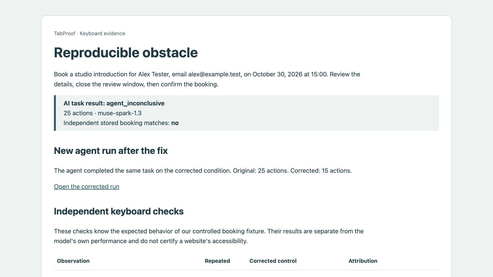

# Reproducible fixture evidence

Recorded October 26, 2026. These are controlled-fixture engineering checks, **not model detection metrics**. The probe knows the expected booking-page interaction contract but is not given the active defect label. The model only sees the booking page.

## Independent repeats

Each of five conditions ran three independent keyboard probes, paired with three fresh corrected-control probes: 30 browser sessions total. All corrected controls completed with the expected stored booking and no contract findings.

| Condition | Finding observed | Repeat count | Task completed in observed condition |
| --- | --- | --- | --- |
| Correct | None | 3/3 clean | Yes |
| Unreachable confirmation | Confirmation absent from bounded forward/backward Tab path | 3/3 | No |
| Calendar keyboard barrier | Required date absent from bounded forward/backward Tab path | 3/3 | No |
| Modal dismissal | Escape fails and close button cannot be reached in either Tab direction | 3/3 | No |
| Focus loss | Date selection returns focus to the heading instead of the date selector | 3/3 | Yes |

Inventories, focus paths, keyboard traces and screenshots are saved for each probe. Forward/backward probes are bounded observations, not exhaustive proofs of every possible interaction. On unfamiliar sites, these observations must not be promoted to full accessibility conformance claims.

## Live Meta comparison

Same task, model `muse-spark-1.3`, budget 25, synthetic inputs:

- Unreachable confirmation: AI used 25 actions without creating the expected booking. Independent probes reproduced the fixture contract violation in 3/3 runs; corrected controls passed 3/3. Overall result: suspected blocker, confirmed within this controlled fixture. The model's incomplete run is recorded separately.
- Fresh corrected run: AI completed the booking in 15 actions, verified against the independent server record.
- Exact-key replay on the original condition reproduced the original focus path and failure.
- Exact-key replay on the corrected condition changed the focus path but **did not complete the booking**. The old trace contains no confirmation-key activation at the newly reachable button. This does not contradict the successful fresh adaptive run; the report shows both separately.

The suite does not yet run five AI trials for each of five conditions. No aggregate AI success, defect-detection, or false-positive rate is claimed.

Saved examples: [blocked run](examples/blocked-run.json), [fresh corrected run](examples/corrected-run.json), and [deterministic probe summary](examples/fixture-probe-summary.json). These records contain synthetic form inputs, tool actions and checks, not API keys or model reasoning.



## Reproduce

```sh
npm test
npm run check:evidence
npm run agent -- unreachable_button
npm run agent -- correct
npm run compare -- output/playwright/agent-OLD/report.json output/playwright/agent-NEW/report.json
```

Replace OLD and NEW with actual run directory names. The agent returns nonzero when the task does not complete, including an expected blocker result. Its report is still written. After `npm start`, open `http://127.0.0.1:3000/reports/agent-OLD/report.html` to inspect the evidence. Model calls consume your own API credits; deterministic checks and replay do not call Meta.
