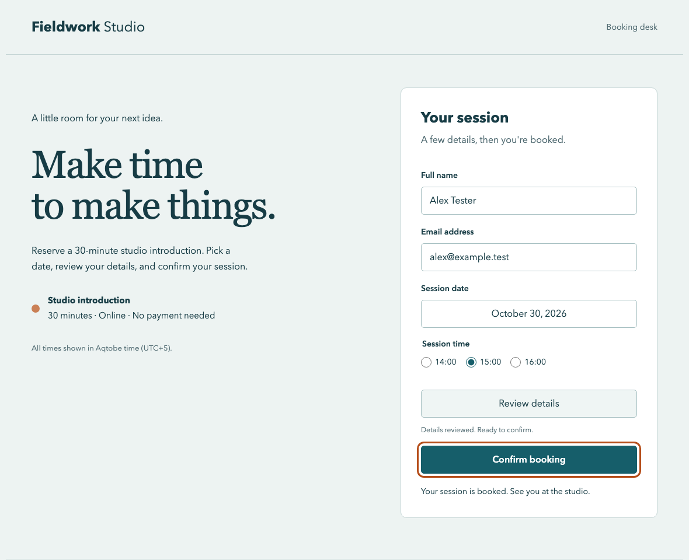

# First working booking run

Recorded October 26, 2026. Model: `muse-spark-1.3` through Meta Model API Responses. Chromium driven by Playwright 1.64.1. Fresh context, corrected fixture, 25-action budget. Synthetic data only.

## Result

**Task completed in 15 actions.** The fixture server's independent record matched all four expected fields:

```json
{"name":"Alex Tester","email":"alex@example.test","date":"2026-10-30","time":"15:00"}
```

The model did not receive the server record, injected condition label, or test-control panel. It received screenshots, visible accessible semantics, current focus, and prior action results. The local executor accepted only `type_text` and allowlisted `press_key` calls.

| Step | Keyboard action |
| --- | --- |
| 1 | Type Alex Tester |
| 2 | Tab to email |
| 3 | Type alex@example.test |
| 4 | Tab to date selector |
| 5 | Enter to open available dates |
| 6–7 | Tab twice to October 30 |
| 8 | Enter to select date |
| 9 | Tab to time radio group |
| 10 | ArrowRight to 15:00 |
| 11 | Tab to review |
| 12 | Enter to open review dialog |
| 13 | Escape to close review |
| 14 | Tab to confirm |
| 15 | Enter to book |



## Checks completed

- The corrected fixture completes with keyboard events and a matching server record.
- Each of four single-defect fixtures exhibits its specific expected behavior in deterministic keyboard checks: unreachable confirmation, non-operable date options, no keyboard modal dismissal, wrong focus restoration after date selection.
- An executor boundary test rejects mouse/focus/script/navigation/submission tool names, unexpected parameters, unsupported key combinations, control characters, excessive text, and actions beyond the budget before browser interaction.
- Meta image input, function calls, and stateless multi-turn replay with encrypted reasoning worked in this run.

## Limits

This is one successful AI run, not a reliability estimate or a completed 25-run benchmark. The fixture checks establish ground truth; they do not establish the model's defect-detection rate. The current live runner reports completion or an inconclusive run; suspected-blocker attribution, independent replay and a general Tab probe are not implemented yet. Focus-loss defects may still allow eventual task completion, so completion alone must not become an accessibility verdict.

During development, the time dropdown was replaced with native radio buttons after automated keyboard selection did not reliably commit a value in this Chromium/macOS setup. The fixture checks exercise the current radio-based UI. The current executor accepts printable ASCII text only, sufficient for these synthetic inputs; international text support remains future work.

No hidden DOM mutation, mouse click, targeted `fill`, programmatic focus, or direct submission is available through the agent's action tools. Normal fixture code manages its own focus when dialogs and calendars open/close, as a website normally does.
